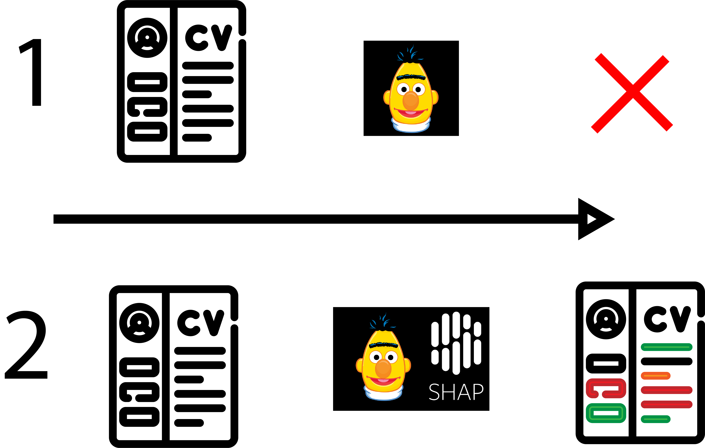

{: .mx-auto.d-block :}

Imagine this, you are a software engineer 👩‍💻 that just applied for a senior position at Ai Inc. As the name might imply, an automated ‘BERT’ black-box solution is used to screen your CV. 

Within a few minutes, you receive a decline ❌ and you reply asking for feedback. After three weeks of silence, you start to wonder what happened. As it turns out they simply couldn’t provide you with any feedback 😶, as their model only returns a ‘yes/no’ answer to any CV that it is given. 

Fortunately #SHAP, an open-source interpretability library, just released support for their model. They rush, work over hours, and manage to implement a new solution within a week! You finally receive an annotated CV indicating what contributed to the decline. Turns out they liked your C++ skills, but you had too little work experience 💡. You finish reading satisfied and continue your search.

Curious as to how these techniques can be applied? Check out my recent #quicktip: [Github + Colab](https://github.com/VHeusinkveld/quick-tips/tree/main/nlp/2021_04_22_shap_for_huggingface_transformers) 🎓. These tools aren’t the be-all and end-all of responsible ML solutions, but they can be a great aid in their design.
